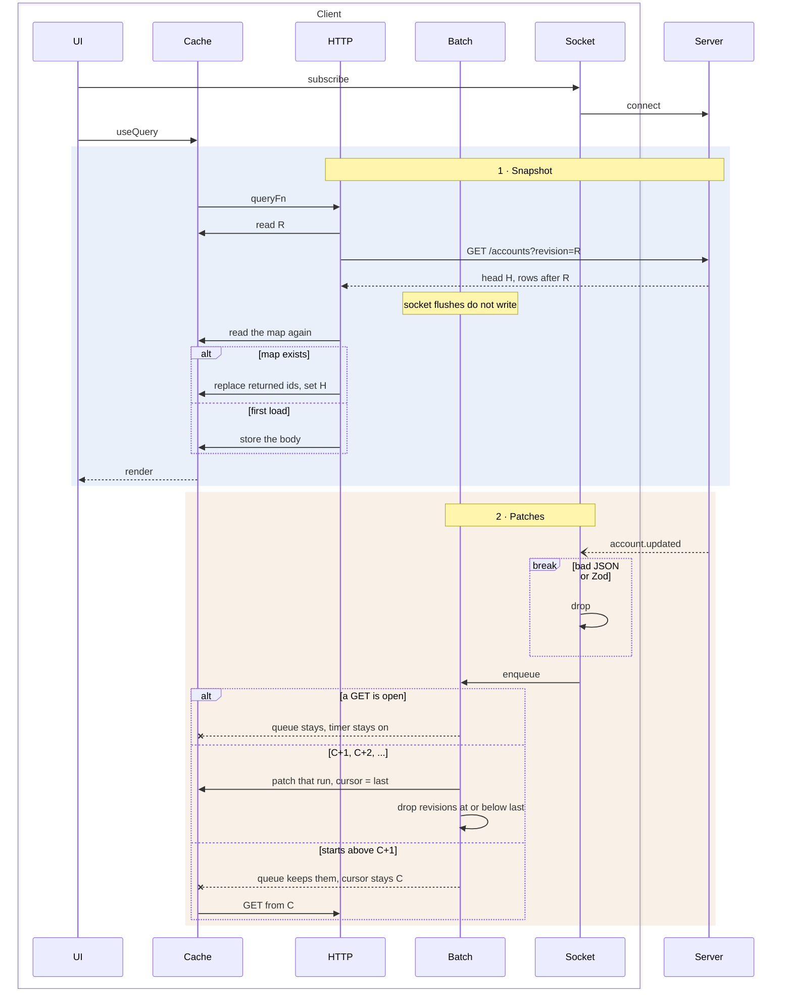
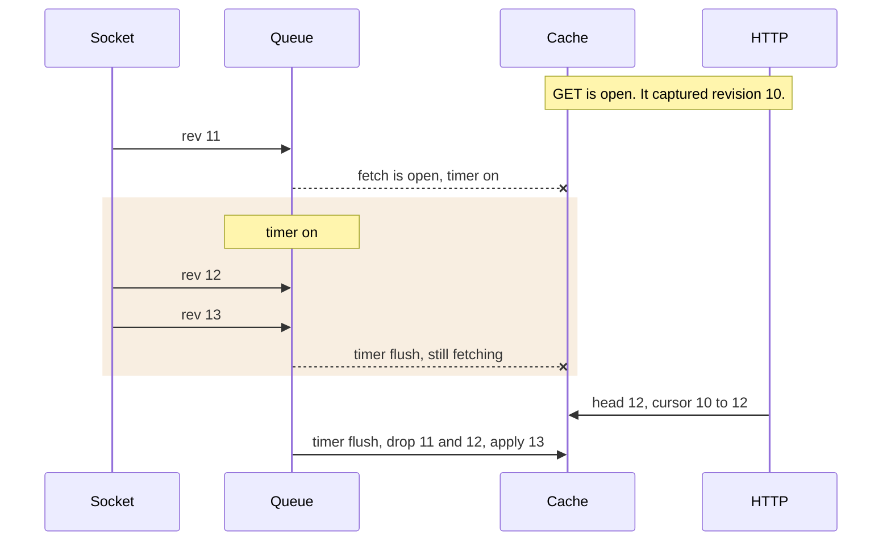
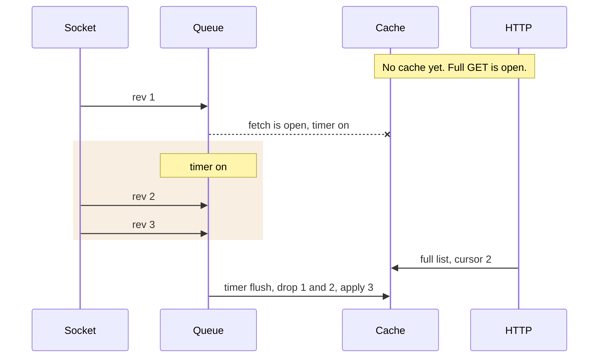
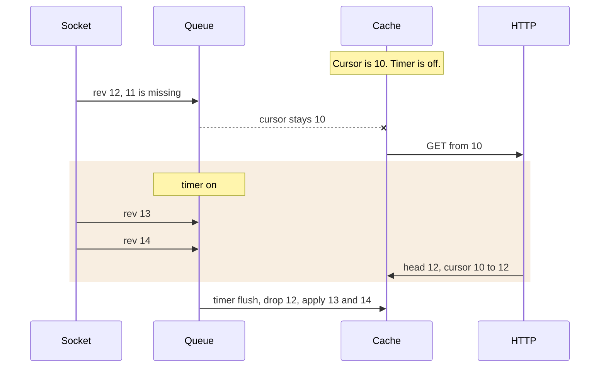
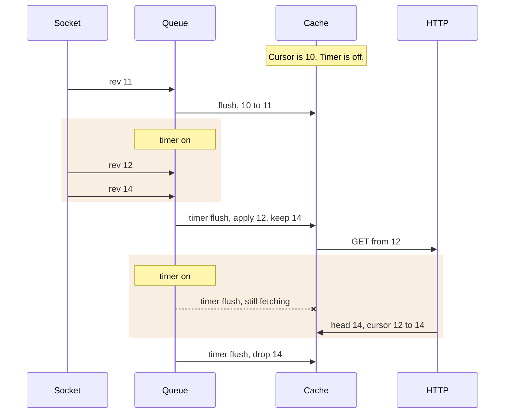

# Accounts cache

HTTP writes full rows and the server head. The socket writes a patch only when the next revision is `C+1`, and only while no GET is open.

| Step | What happens |
| --- | --- |
| Snapshot | `R` is sent only when the cache has one. The server skips `R` and returns full rows changed after it. Stored revision becomes `H`. |
| While a GET is open | The flush does not write. Messages stay in the queue. The timer tries again. |
| `C+1, C+2, ...` | Those accounts are patched. The cursor becomes the last revision in the run. Those messages leave the queue. The timer arms for 1s. |
| Starts above `C+1` | Nothing is patched. The cursor stays `C`. Messages newer than `C` stay. A GET starts from `C`. |
| A hole after a prefix | The prefix is patched and the cursor moves to its last revision. The tail stays in the queue. A GET starts from that cursor. |
| Nothing newer | Revisions at or below `C` leave the queue. The cache is unchanged. The next timer tick finds an empty queue and stops. |
| A missing id | The account is left unchanged. The cursor still moves past that revision, and the message leaves the queue. |
| Throttle | The first flush is immediate. A finished flush arms 1s, even when the queue is empty. A flush that waits arms 1s only when the queue still has messages. Cap is 1000, oldest dropped. |

# Overlap

One GET is already in flight. It captured revision 10. Socket messages wait until it finishes.

| Moment | Cursor | Queue |
| --- | --- | --- |
| 11 arrives | 10 | 11, timer on |
| 12 and 13 arrive | 10 | 11, 12, 13 |
| Timer flush while the GET is open | 10 | 11, 12, 13, timer on |
| Body built at 12 | 12 | 11, 12, 13 |
| Timer flush | 13 | empty, timer armed |

The socket does not write during the GET, so the body cannot move the cursor backward. 11 and 12 are already in that body. 13 is 12 + 1, so the next timer applies it.

# No cache yet

The full list is still in flight. The first socket message arms the timer. Later messages wait. Each timer flush finds the GET still open and arms again.

| Moment | Cursor | Queue |
| --- | --- | --- |
| 1 arrives, then 2 and 3 | none | grows to 1, 2, 3, timer on |
| Full list is stored | 2 | still 1, 2, 3 |
| Timer flush | 3 | empty, timer armed |

The list was built at revision 2, so 1 and 2 are already in it. 3 happened after that. The timer applies it. It does not wait for message 4.

# Missing revision

11 never arrived. The cursor is 10. 12 is not patched. It stays in the queue, and a GET from 10 starts.

| Moment | Cursor | Queue |
| --- | --- | --- |
| Flush of 12 | 10 | 12, GET from 10, timer on |
| 13 and 14 arrive | 10 | 12, 13, 14 |
| Body built at 12 | 12 | 12, 13, 14 |
| Timer flush | 14 | empty, timer armed |

The diff includes the missing 11, and the row for 12. 13 is 12 + 1, so the held messages move the cursor to 14. No second GET is requested.

# A hole after a prefix

The cursor is 10. 11 and 12 are applied. 14 waits, because 13 is missing. A GET starts from 12.

| Moment | Cursor | Queue |
| --- | --- | --- |
| Flush of 11 | 11 | empty, timer armed |
| 12 and 14 arrive | 11 | 12, 14 |
| Timer flush | 12 | 14, GET from 12, timer on |
| Timer flush while the GET is open | 12 | 14 |
| Body built at 14 | 14 | 14 |
| Timer flush | 14 | empty, timer armed |

12 follows 11, so it is patched. 14 does not follow 12, so it stays. The body includes the missing 13 and the row for 14. The next timer drops 14, because the cursor is already there.
